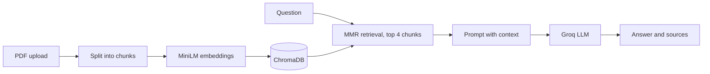

# Intelligent Document AI – RAG Chatbot

Upload PDFs and ask questions about them. Answers are generated only from your documents, and every answer shows the source file, page number and the matching text.

<!-- Add a screenshot or GIF here, for example:  -->

## Features

- **PDF upload** by drag and drop or file picker, up to 200 MB
- **Background indexing with live progress** (for example "Processing 57%"). A document is marked Ready only after indexing has really finished
- **Grounded answers** using retrieved context, with expandable **sources** (file name, page, snippet)
- **Copy answer** button, typing indicator and simple Markdown rendering
- **Dark and light theme**, chat history saved in the browser, and a settings dialog for the backend URL
- **Responsive UI** built with plain HTML, CSS and JavaScript (no frameworks)
- **Single server**: FastAPI serves both the API and the frontend

## Tech stack

| Part | Technology |
| --- | --- |
| Backend | FastAPI, Uvicorn |
| RAG pipeline | LangChain |
| Vector database | ChromaDB |
| Embeddings | `sentence-transformers/all-MiniLM-L6-v2` (Hugging Face) |
| LLM | Groq (`openai/gpt-oss-20b`) |
| PDF loading | PyPDFLoader (`pypdf`) |
| Frontend | HTML5, CSS3, vanilla JavaScript |

## How it works



1. **Upload:** the PDF is streamed to a temporary file and a background job is started, so the request returns immediately.
2. **Indexing:** the job splits the text into chunks (1000 characters, 150 overlap), embeds them and adds them to ChromaDB in batches of 200. The frontend polls the job to show progress.
3. **Asking:** the question is matched against the stored chunks with MMR retrieval (`k=4`). The chunks are sent to the LLM with a prompt that allows answers only from that context.
4. **Answer:** the response is returned with the sources (file name, page, snippet) of the retrieved chunks.

## Project structure

```
.
├── app2.py              # FastAPI app: API, background indexing, serves the frontend
├── create_database.py   # optional script to pre-load a PDF into ChromaDB
├── main.py              # terminal version of the chatbot for quick testing
├── requirements.txt
├── .gitignore
└── static/              # frontend
    ├── index.html
    ├── style.css
    ├── script.js
    └── logo.svg
```

The `ChromaDB/` folder is created automatically when the app runs and is not committed to Git.

## Getting started

**Requirements:** Python 3.10 or newer and a [Groq API key](https://console.groq.com/).

```bash
git clone https://github.com/Aryankhorwal2006-Jesus/Document-AI-RAG.git
cd Document-AI-RAG

python -m venv .venv
source .venv/bin/activate        # Windows: .venv\Scripts\activate

pip install -r requirements.txt
```

Create a `.env` file next to `app2.py`:

```
GROQ_API_KEY=your_key_here
```

Start the app:

```bash
python app2.py
```

This starts the server at **http://127.0.0.1:8000** and opens it in your browser once it is ready. The first start is slower because the embedding model is downloaded and loaded. You can also run it directly:

```bash
uvicorn app2:app --reload
```

## API

| Method | Endpoint | Description |
| --- | --- | --- |
| `GET` | `/health` | Checks that the backend is running |
| `POST` | `/ask` | Body: `{"question": "..."}`. Returns `answer` and `sources` |
| `POST` | `/upload` | Form field `file` (PDF). Returns `202` with a `job_id` |
| `GET` | `/upload/{job_id}` | Indexing progress: `status`, `stage`, `done`, `total`, `error` |

Interactive docs are available at `/docs`.

Example response from `/ask`:

```json
{
  "answer": "Deep learning is ...",
  "sources": [
    { "page": 1, "source": "deeplearning.pdf", "snippet": "Deep learning is a subset ..." }
  ]
}
```

## Configuration

The main settings are constants at the top of `app2.py`:

| Setting | Default | Meaning |
| --- | --- | --- |
| `PERSIST_DIR` | `ChromaDB` | Where the vector database is stored |
| `EMBEDDING_MODEL` | `all-MiniLM-L6-v2` | Embedding model |
| `LLM_MODEL` | `openai/gpt-oss-20b` | Groq model used for answers |
| `MAX_UPLOAD_MB` | `200` | Maximum PDF size |
| `BATCH` | `200` | Chunks embedded per step |

## Known limitations

- Retrieval searches **all** documents in the database, not only the file you uploaded last, so sources can come from older PDFs.
- The backend does not keep chat memory, so every question is answered on its own.
- Removing a document from the sidebar only removes it from the list. It does not delete its data from ChromaDB.
- Scanned PDFs (images only) have no readable text and are rejected. They would need OCR.
- PDFs are indexed one at a time, and upload progress is kept in memory, so it is lost if the server restarts.

## Deployment (Render)

- **Build command:** `pip install -r requirements.txt`
- **Start command:** `uvicorn app2:app --host 0.0.0.0 --port $PORT`
- **Environment variable:** `GROQ_API_KEY`

Notes: the free instance has limited RAM, which may be too small for the embedding model. Its disk is temporary, so the `ChromaDB` folder is reset on restart or redeploy unless you attach a persistent disk.

## Roadmap

- [ ] Filter answers by selected document
- [ ] Delete a document from ChromaDB
- [ ] Chat memory for follow-up questions
- [ ] Streaming answers
- [ ] OCR support for scanned PDFs

## Author

**Aryan Khorwal** · [GitHub](https://github.com/Aryankhorwal2006-Jesus)
